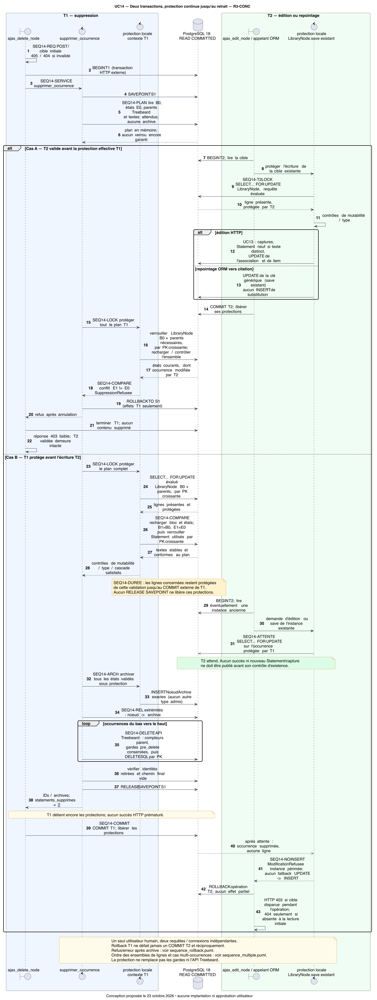
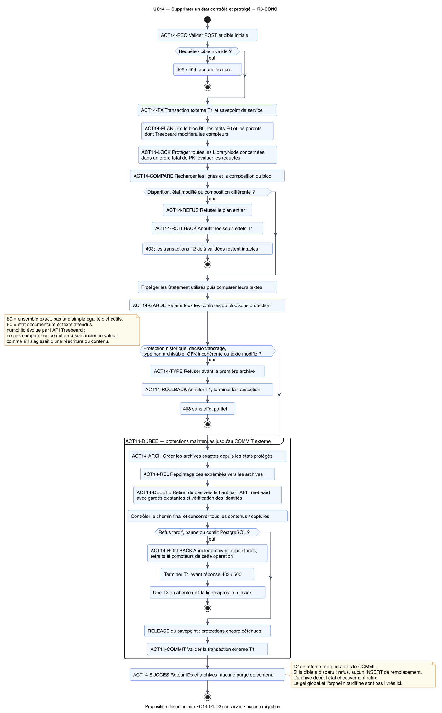
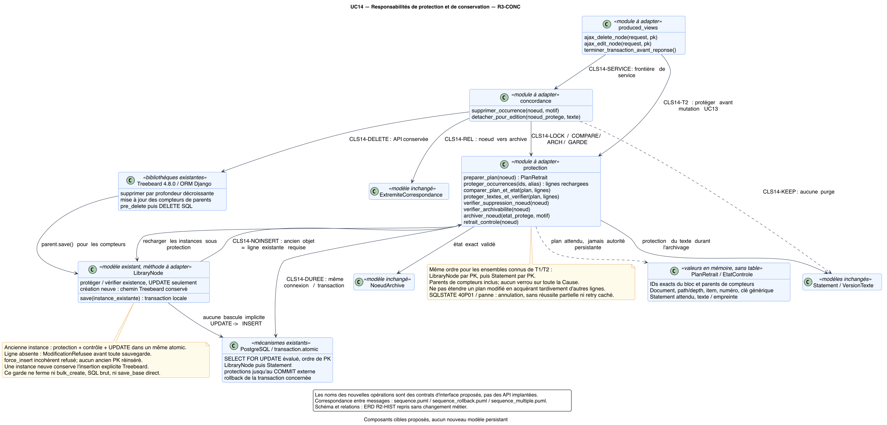

# UC14 R3-CONC — Diagrammes soumis à validation

**23 octobre 2026 — branche documentaire `docs/uc14-r3-conc-20261023`.**
Publication des artefacts exacts présentés dans la session. Base documentaire :
`976982394cc1c8046eec4e5ed5ab3e866bcdbb5b`, publication des modèles transversaux.
La branche est destinée à l'examen, sans fusion dans `main` ni changement
applicatif. Aucun patch de correction n'est appliqué par cette publication.

**Conception R3-CONC : VALIDE_ARCHITECTURE selon la revue indépendante;
approbation utilisateur : AUCUNE.** Le candidat applicatif `f35ec85` demeure
NON CONFORME; les essais R3 ne sont pas exécutés. Cette publication ne vaut
pas autorisation de corriger le code.

## Diagrammes à examiner

Les PNG s'affichent directement sur GitHub. Les SVG permettent l'examen en
grand format; les sources PlantUML sont conservées pour reproduction.

| Vue | Aperçu PNG | SVG | Source PlantUML |
|---|---|---|---|
| Séquence T1/T2 : deux issues conformes, verrou et commit externe | [PNG](use_cases/UC-C-14/revisions/R3-CONC/sequence.png) | [SVG](use_cases/UC-C-14/revisions/R3-CONC/sequence.svg) | [PUML](use_cases/UC-C-14/revisions/R3-CONC/sequence.puml) |
| Activité de suppression UC14 | [PNG](use_cases/UC-C-14/revisions/R3-CONC/activity.png) | [SVG](use_cases/UC-C-14/revisions/R3-CONC/activity.svg) | [PUML](use_cases/UC-C-14/revisions/R3-CONC/activity.puml) |
| Classes et responsabilités transactionnelles | [PNG](use_cases/UC-C-14/revisions/R3-CONC/class.png) | [SVG](use_cases/UC-C-14/revisions/R3-CONC/class.svg) | [PUML](use_cases/UC-C-14/revisions/R3-CONC/class.puml) |
| ERD R2-HIST conservé, aucun changement métier | [PNG](use_cases/UC-C-14/revisions/R3-CONC/erd.png) | [SVG](use_cases/UC-C-14/revisions/R3-CONC/erd.svg) | [PUML](use_cases/UC-C-14/revisions/R3-CONC/erd.puml) |
| Complément : annulation T1 et reprise T2 | [PNG](use_cases/UC-C-14/revisions/R3-CONC/sequence_rollback.png) | [SVG](use_cases/UC-C-14/revisions/R3-CONC/sequence_rollback.svg) | [PUML](use_cases/UC-C-14/revisions/R3-CONC/sequence_rollback.puml) |
| Complément : plusieurs occurrences et effets indépendants | [PNG](use_cases/UC-C-14/revisions/R3-CONC/sequence_multiple.png) | [SVG](use_cases/UC-C-14/revisions/R3-CONC/sequence_multiple.svg) | [PUML](use_cases/UC-C-14/revisions/R3-CONC/sequence_multiple.puml) |
| Complément : édition UC13 / sauvegarde ORM T2 | [PNG](use_cases/UC-C-14/revisions/R3-CONC/activity_t2.png) | [SVG](use_cases/UC-C-14/revisions/R3-CONC/activity_t2.svg) | [PUML](use_cases/UC-C-14/revisions/R3-CONC/activity_t2.puml) |

Afficher la séquence principale T1/T2

Afficher l'activité de suppression

Afficher les responsabilités de classes et services

Afficher l'ERD conservé

## Pièces de validation et références

| Pièce | Lien |
|---|---|
| Dossier R3-CONC complet | [README](use_cases/UC-C-14/revisions/R3-CONC/README.md) |
| Défaut, mécanisme, cohérence et périmètre des cinq fichiers proposé | [Analyse](use_cases/UC-C-14/revisions/R3-CONC/analyse_coherence.md) |
| AC01–AC07 conservés et garanties techniques proposées | [Spécification](use_cases/UC-C-14/revisions/R3-CONC/specification.md) |
| Revue indépendante de conception et limites de son verdict | [Validation](use_cases/UC-C-14/revisions/R3-CONC/validation.md), [attestation B](use_cases/UC-C-14/revisions/R3-CONC/revue_B.md) |
| Essais T01–T24 prévus, NON EXECUTES | [Plan d'essais](use_cases/UC-C-14/revisions/R3-CONC/plan_tests.md), [traçabilité](use_cases/UC-C-14/revisions/R3-CONC/tracabilite.md) |
| Sources et rendus exacts soumis à la revue | [Manifeste de conception](use_cases/UC-C-14/revisions/R3-CONC/manifest_conception.json) |
| Livraison complète et contrôles réellement exécutés | [Manifeste de livraison](use_cases/UC-C-14/revisions/R3-CONC/manifest_livraison.json), [contrôles documentaires](use_cases/UC-C-14/revisions/R3-CONC/controles_documentaires.json) |
| Constat du défaut ayant motivé la révision | [Revue B01](lots/C0-A/REVUE_INDEPENDANTE_B01.md), [preuves historiques](lots/C0-A/preuves_revue_B01/README.md) |
| Références approuvées préservées | [UC13 R2-ST](versions_approuvees/UC-C-13_C0A-UML-R2-ST/README.md), [UC14 R2-HIST](versions_approuvees/UC-C-14_C0A-UML-R2-HIST/README.md), [UC15 R2-DIAG](versions_approuvees/UC-C-15_C0A-UML-R2-DIAG/README.md) |
| Statuts par version | [Registre unique](registre_validation.md) |

SHA-256 du manifeste de conception examiné :
`258ca9a719c0b172461f75dc5f27bb98b74335b532340c00654b5165f7e87b0d`.
SHA-256 du manifeste de livraison :
`b1ecaf1ebb55cc84b989153c1b6536836cdfbf3184c7d0e59cb2498fc27818ba`.

Les fichiers R3-CONC sont publiés sans réécriture. Seul le chemin d'inclusion
du style dans la copie de l'ERD diffère de R2-HIST, comme documenté lors de la
revue. Les anciennes vues, leurs archives approuvées et leurs manifestes
restent intacts. Les preuves B01 et les patches conservés sont documentaires;
ils ne sont ni appliqués ni réexécutés ici. L'orphelin tardif reste distinct.

## Décision attendue

Examiner cette version précise, puis décider explicitement de l'approbation
de la conception et de l'autorisation éventuelle de la correction isolée.
La preuve opérationnelle attendra le futur candidat, les essais PostgreSQL
et sa nouvelle revue indépendante. Aucune autorisation de fusion ou de
déploiement ne découle de la mise à disposition sur GitHub.
