# Revue graphique C0-A — UC14, UC15 et comportements liés aux citations

**Livraison du 20 octobre 2026 — conception documentaire à examiner.**
L’approbation UC13::C0A_ISOLER C0A-UML-R2-ST est enregistrée séparément
(commit af52eef), au manifeste de la PR #30 / cd584c3.
[Décision et exclusions](use_cases/UC-C-13/approbation.json) ·
[Version approuvée préservée](versions_approuvees/UC-C-13_C0A-UML-R2-ST/README.md).
Ses quatre sources et huit rendus sont inchangés. Aucun lot prêt au développement.

| Dossier | Version / revue B | Décision utilisateur |
|---|---|---|
| [UC14 — suppression](use_cases/UC-C-14/specification.md) | R2-HIST, VALIDE_ARCHITECTURE pour l’option conservatrice C14-D1/D2 | À approuver avec les quatre vues |
| [UC15 — appuis d’origine](use_cases/UC-C-15/specification.md) | R2-DIAG, VALIDE_ARCHITECTURE pour le contrat C15-D1 | À approuver avec les quatre vues |
| [UC02::RENOMMER_CITATION](use_cases/UC-C-02/RENOMMER_CITATION/specification.md) | CIT-UML-R1, EN_REVUE; quatre vues | CIT-D1/D2 ouverts |
| [UC12::DIAGNOSTIQUER_EXAMEN](use_cases/UC-C-12/DIAGNOSTIQUER_EXAMEN/specification.md) | CIT-UML-R1, EN_REVUE; quatre vues + états | CIT-D3/D4 ouverts |
| [Modèle consolidé C0-A](modele_global/README.md) | G-C0A-R3-CIT proposé; deux vues | Aucune approbation transférée de G-R2 |

Les diagrammes ci-dessous sont les artefacts centraux. Ouvrir les SVG pour
zoomer sur les grands schémas. Les sources PlantUML, SVG et PNG sont conservés.
Les 38 anciens scénarios NR/CF3 et 38 nouveaux scénarios C14/C15/CIT restent
planifiés; aucun essai applicatif nouveau n’est exécuté dans ce mandat.

## A. UC14 — suppression sans perte

**C14-D1 proposé :** supprimer les occurrences, conserver tous les Statement
et VersionTexte; pas de purge automatique C0-A.
**C14-D2 proposé :** refuser tout le bloc contenant un contenu non Statement,
un objet disparu ou une GFK incohérente, faute d’archive typée fidèle.
Les protections historiques et décisions/ancrages non archivables font
également refuser tout le bloc. Le rollback inclut archives et repointages.

[Spécification](use_cases/UC-C-14/specification.md) ·
[Traçabilité](use_cases/UC-C-14/tracabilite.md) ·
[Attestation B](use_cases/UC-C-14/validation.md) ·
[Manifeste](use_cases/UC-C-14/manifest_sha256.json) ·
[Comparer les vues R1 conservées](historique/2026-10-20_avant_invariants_statement_R2/corpus/use_cases/UC-C-14/specification.md).

### UC14 — Activité

[SVG](use_cases/UC-C-14/activity.svg) · [PlantUML](use_cases/UC-C-14/activity.puml) · [PNG](use_cases/UC-C-14/activity.png)

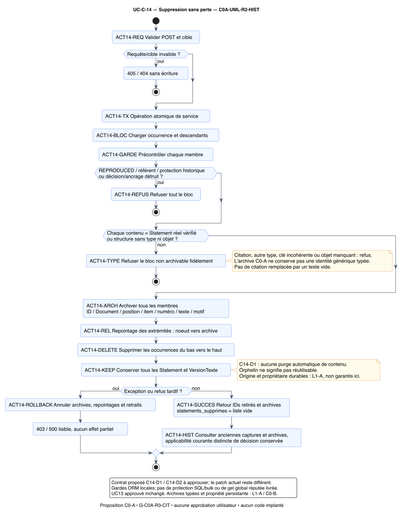

### UC14 — Séquence

[SVG](use_cases/UC-C-14/sequence.svg) · [PlantUML](use_cases/UC-C-14/sequence.puml) · [PNG](use_cases/UC-C-14/sequence.png)

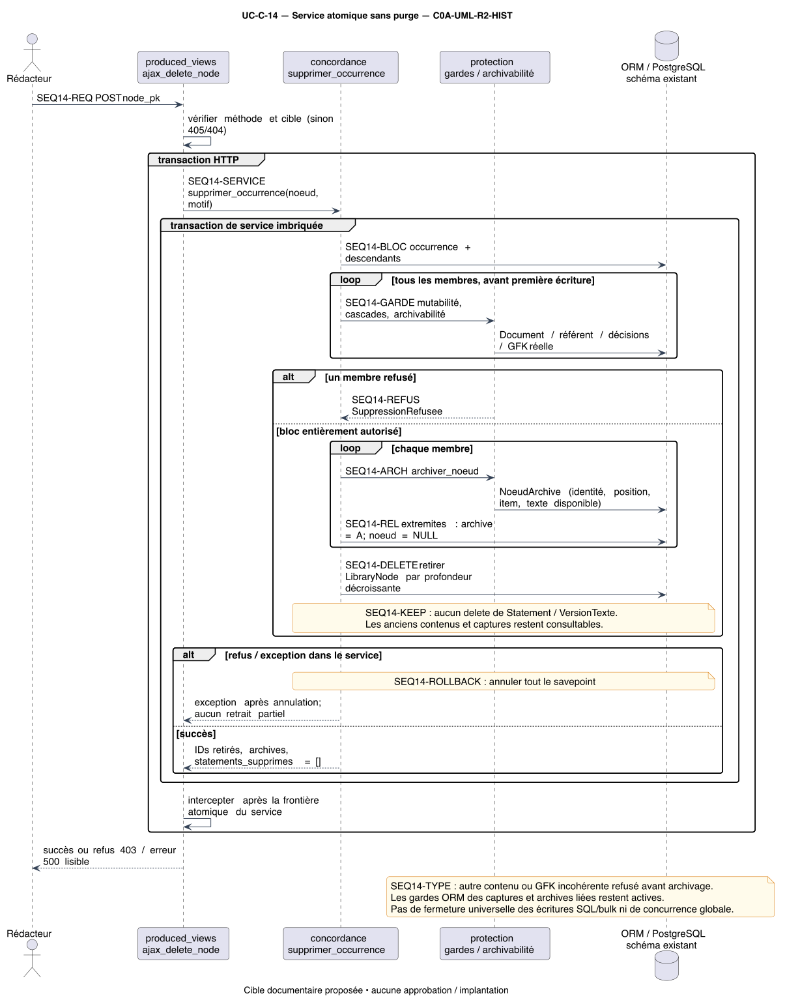

### UC14 — ERD

[SVG](use_cases/UC-C-14/erd.svg) · [PlantUML](use_cases/UC-C-14/erd.puml) · [PNG](use_cases/UC-C-14/erd.png)

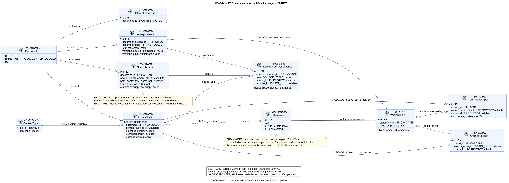

### UC14 — Classes et responsabilités

[SVG](use_cases/UC-C-14/class.svg) · [PlantUML](use_cases/UC-C-14/class.puml) · [PNG](use_cases/UC-C-14/class.png)

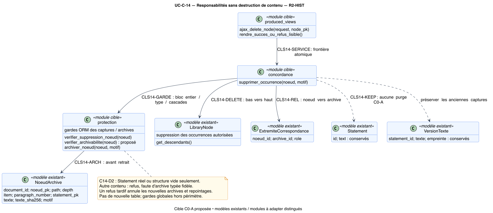

## B. UC15 — appuis conservés, anomalies et strict distincts

**C15-D1 proposé :** toute origine valide du bon couple reste visible; une
anomalie locale ajoute un diagnostic sans effacer les autres appuis. Une
erreur de contexte ou une panne fait échouer la lecture. Les anomalies de
résolution alimentent EX04 et bloquent le strict, même si des appuis valides
restent consultables. Les sept EX restent cumulatifs.

[Spécification](use_cases/UC-C-15/specification.md) ·
[Traçabilité](use_cases/UC-C-15/tracabilite.md) ·
[Attestation B](use_cases/UC-C-15/validation.md) ·
[Manifeste](use_cases/UC-C-15/manifest_sha256.json) ·
[Comparer R1](historique/2026-10-20_avant_invariants_statement_R2/corpus/use_cases/UC-C-15/specification.md).
**C0A-REV-01 reste ouverte dans le patch**; aucune correction testée ou implantée.

### UC15 — Activité

[SVG](use_cases/UC-C-15/activity.svg) · [PlantUML](use_cases/UC-C-15/activity.puml) · [PNG](use_cases/UC-C-15/activity.png)

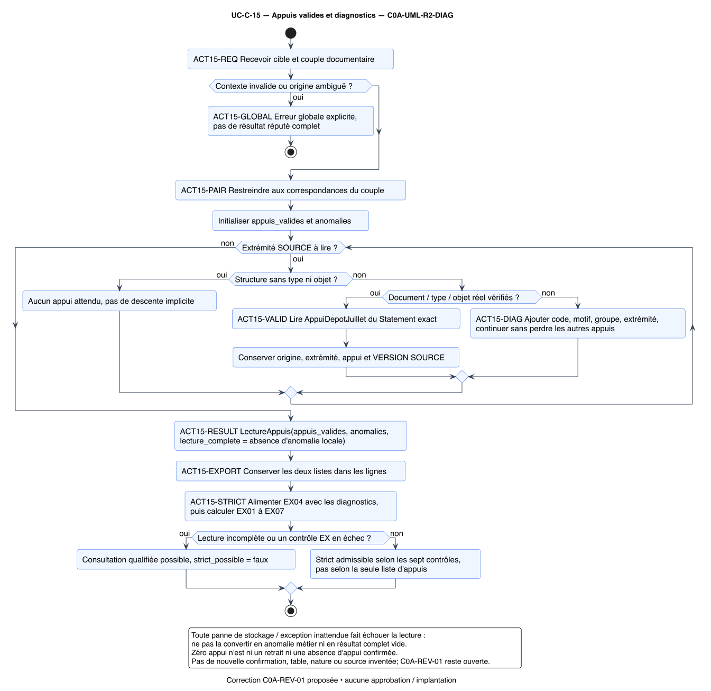

### UC15 — Séquence

[SVG](use_cases/UC-C-15/sequence.svg) · [PlantUML](use_cases/UC-C-15/sequence.puml) · [PNG](use_cases/UC-C-15/sequence.png)

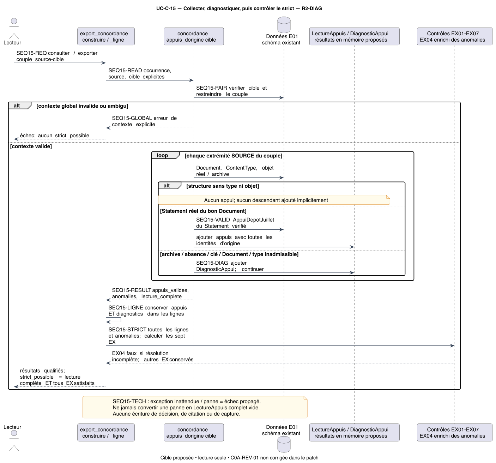

### UC15 — ERD

[SVG](use_cases/UC-C-15/erd.svg) · [PlantUML](use_cases/UC-C-15/erd.puml) · [PNG](use_cases/UC-C-15/erd.png)

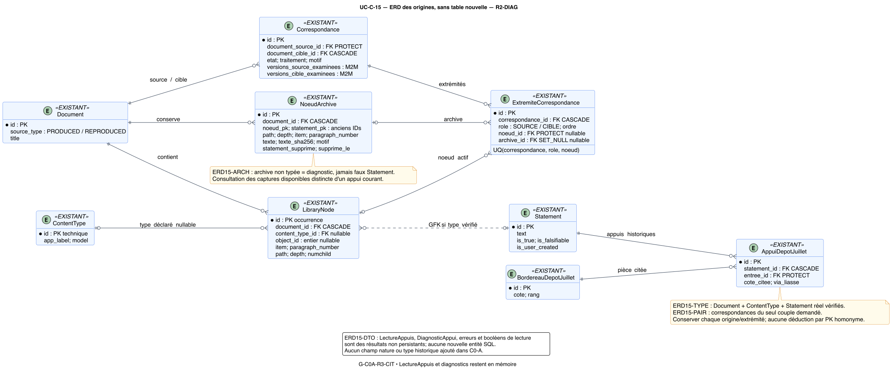

### UC15 — Classes et responsabilités

[SVG](use_cases/UC-C-15/class.svg) · [PlantUML](use_cases/UC-C-15/class.puml) · [PNG](use_cases/UC-C-15/class.png)

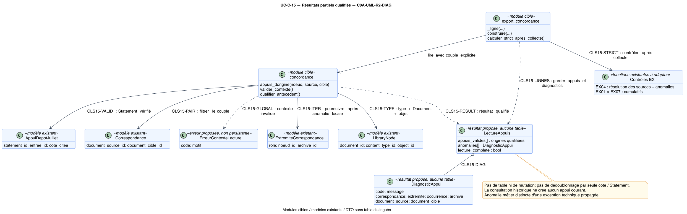

## C. Citations — deux responsabilités proposées

[Analyse ciblée et arbitrages](ANALYSE_CIBLEE_CITATIONS_C0A.md).
Le renommage de l’occurrence relève d’UC02, par une action distincte du profil
UC13 approuvé. Recommandation CIT-D1/D2 : item seul, source intacte, refus de
toute incidence de rôle/numéro ou de contexte d’examen non conservable.
Le refus HTTP 403 actuel n’est pas pris pour une décision approuvée.

La consultation de l’examen relève d’UC12, son nouvel ajout d’UC05E.
Recommandation CIT-D3/D4 : distinguer décision, fraîcheur, capture absente,
type hors contrat et possibilité réelle de nouvel examen. Le chemin futur
attend le journal immuable et le type/adaptateur nécessaires; pas de boucle
de reconfirmation par une fonction qui écrase l’ancien état.

### UC02 — intitulé de citation

[Spécification](use_cases/UC-C-02/RENOMMER_CITATION/specification.md) · [Traçabilité](use_cases/UC-C-02/RENOMMER_CITATION/tracabilite.md) · [Revue B et réserves](use_cases/UC-C-02/RENOMMER_CITATION/validation.md).

| Vue | Rendu | Source |
|---|---|---|
| Activité | [SVG](use_cases/UC-C-02/RENOMMER_CITATION/activity.svg) · [PNG](use_cases/UC-C-02/RENOMMER_CITATION/activity.png) | [PlantUML](use_cases/UC-C-02/RENOMMER_CITATION/activity.puml) |
| Séquence | [SVG](use_cases/UC-C-02/RENOMMER_CITATION/sequence.svg) · [PNG](use_cases/UC-C-02/RENOMMER_CITATION/sequence.png) | [PlantUML](use_cases/UC-C-02/RENOMMER_CITATION/sequence.puml) |
| ERD | [SVG](use_cases/UC-C-02/RENOMMER_CITATION/erd.svg) · [PNG](use_cases/UC-C-02/RENOMMER_CITATION/erd.png) | [PlantUML](use_cases/UC-C-02/RENOMMER_CITATION/erd.puml) |
| Classes et responsabilités | [SVG](use_cases/UC-C-02/RENOMMER_CITATION/class.svg) · [PNG](use_cases/UC-C-02/RENOMMER_CITATION/class.png) | [PlantUML](use_cases/UC-C-02/RENOMMER_CITATION/class.puml) |

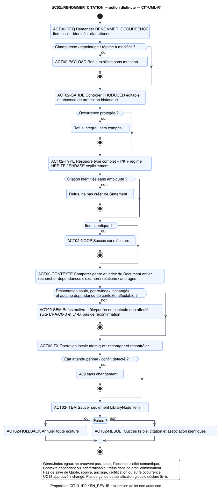

### UC12 — diagnostic de l’examen

[Spécification](use_cases/UC-C-12/DIAGNOSTIQUER_EXAMEN/specification.md) · [Traçabilité](use_cases/UC-C-12/DIAGNOSTIQUER_EXAMEN/tracabilite.md) · [Revue B et réserves](use_cases/UC-C-12/DIAGNOSTIQUER_EXAMEN/validation.md).

| Vue | Rendu | Source |
|---|---|---|
| Activité | [SVG](use_cases/UC-C-12/DIAGNOSTIQUER_EXAMEN/activity.svg) · [PNG](use_cases/UC-C-12/DIAGNOSTIQUER_EXAMEN/activity.png) | [PlantUML](use_cases/UC-C-12/DIAGNOSTIQUER_EXAMEN/activity.puml) |
| Séquence | [SVG](use_cases/UC-C-12/DIAGNOSTIQUER_EXAMEN/sequence.svg) · [PNG](use_cases/UC-C-12/DIAGNOSTIQUER_EXAMEN/sequence.png) | [PlantUML](use_cases/UC-C-12/DIAGNOSTIQUER_EXAMEN/sequence.puml) |
| ERD | [SVG](use_cases/UC-C-12/DIAGNOSTIQUER_EXAMEN/erd.svg) · [PNG](use_cases/UC-C-12/DIAGNOSTIQUER_EXAMEN/erd.png) | [PlantUML](use_cases/UC-C-12/DIAGNOSTIQUER_EXAMEN/erd.puml) |
| Classes et responsabilités | [SVG](use_cases/UC-C-12/DIAGNOSTIQUER_EXAMEN/class.svg) · [PNG](use_cases/UC-C-12/DIAGNOSTIQUER_EXAMEN/class.png) | [PlantUML](use_cases/UC-C-12/DIAGNOSTIQUER_EXAMEN/class.puml) |

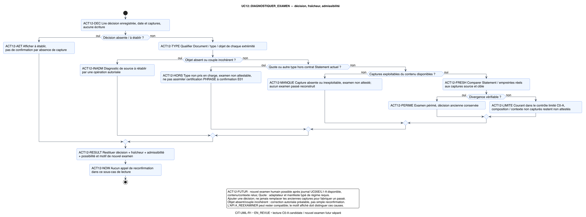

### États de lecture et nouvel examen futur

[SVG](use_cases/UC-C-12/DIAGNOSTIQUER_EXAMEN/states.svg) ·
[PlantUML](use_cases/UC-C-12/DIAGNOSTIQUER_EXAMEN/states.puml) ·
[PNG](use_cases/UC-C-12/DIAGNOSTIQUER_EXAMEN/states.png).

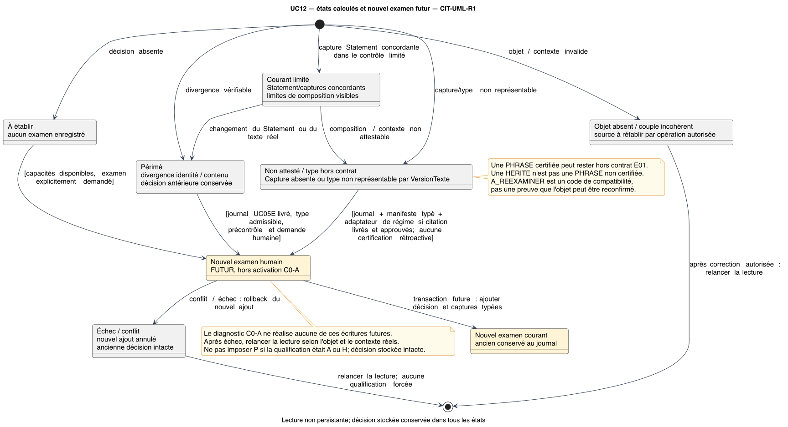

## D. Modèle consolidé proposé

G-C0A-R3-CIT ajoute les types Quote à la projection et distingue les services
rédactionnels, diagnostics et résultats non persistants. Le schéma est inchangé.
Le modèle G-R2 déjà approuvé avec UC13 est conservé séparément.

[ERD SVG](modele_global/erd_consolide.svg) · [PlantUML](modele_global/erd_consolide.puml) · [PNG](modele_global/erd_consolide.png).

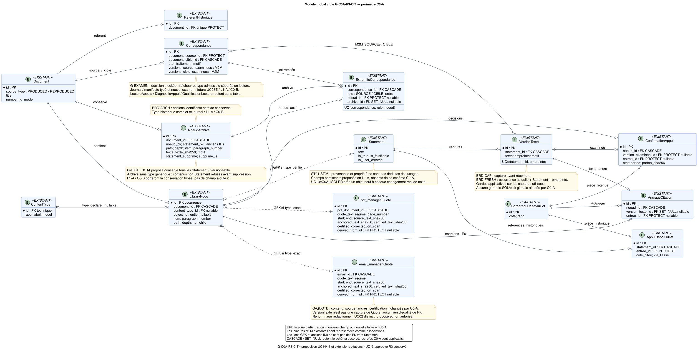

[Classes SVG](modele_global/classes_consolidees.svg) · [PlantUML](modele_global/classes_consolidees.puml) · [PNG](modele_global/classes_consolidees.png).

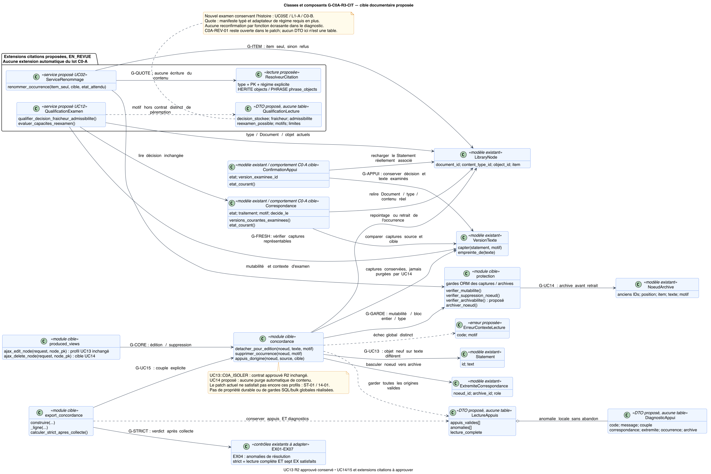

## Décisions proposées et suites

1. Examiner et approuver ou corriger UC14 R2-HIST, en tranchant C14-D1/D2.
2. Examiner et approuver ou corriger UC15 R2-DIAG, contrat C15-D1.
3. Trancher CIT-D1/D2 (renommage limité ou report L1-B) et CIT-D3/D4
   (qualification lisible, nouvel examen après journal/type admissible).
4. Après ces décisions seulement, définir un mandat A borné : fichiers,
   socle autorisé, essais jetables, écarts C0A-ST-01 / C0A-14-01 / C0A-REV-01.

Aucune approbation implicite, autorisation de code, migration ou fusion.
La publication se fait pour revue sur une branche documentaire et sa PR;
les sources, captures et fichiers applicatifs de A restent inchangés.
[Registre courant](registre_validation.md) · [Backlog](BACKLOG_ARCHITECTURE_C.md) ·
[Preuves communes](lots/C0-A/VALIDATION_UML_C0A.json).
