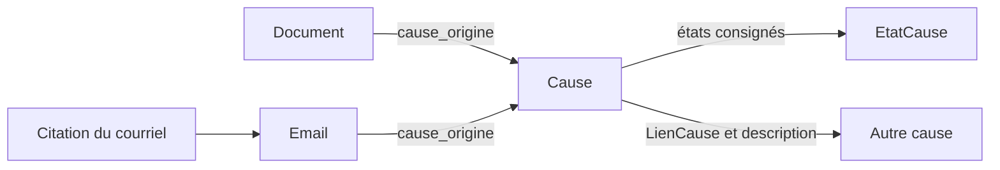

# Causes, actes et versions

Décision de structure du 16 octobre 2026. Ce document complète
[CONCEPTION_PREUVE.md](CONCEPTION_PREUVE.md) et distingue le socle implémenté
de la suite à construire.

## 1. La cause est le contexte judiciaire commun

Une cause possède une identité durable, un numéro de dossier, un titre, un
tribunal, un district judiciaire et un état. Plusieurs causes peuvent être liées : les actes d'une
cause familiale peuvent constituer des éléments de preuve dans une autre cause.

Le rattachement d'origine répond à « dans quelle cause ce document a-t-il été
rédigé ou ce courriel échangé ? ». Il ne répond pas à « dans quelles causes
sert-il de preuve ? ». Cette seconde relation passe par les bordereaux et
les démonstrations propres aux versions des actes qui utilisent la source.

**Précision de LP : le paragraphe de l'acte adverse entre dans un arbre de
preuve associé à la nouvelle cause.** Son inclusion dans cet arbre constitue
une utilisation du paragraphe dans la nouvelle cause; sa provenance reste
l'acte adverse et la cause dans laquelle cet acte a été rédigé. Les deux liens
coexistent et doivent pouvoir être suivis depuis l'élément utilisé.

La cause 505-17-016235-261 est distincte du litige familial dont proviennent
les actes adverses. **Clarification de LP, le 16 octobre 2026 :** la procédure
de 2023 avait été enregistrée dans le mauvais district judiciaire et aurait
dû relever du dossier initial. La différence de numéro explique le moyen
déclinatoire; les numéros figurant dans les documents doivent être conservés.

Vérification sur les numérisations :

| Document | Numéro conservé pour son rattachement | Relation documentée |
|---|---|---|
| Actes de 2015 et 2019 — documents 1 et 3 | 505-04-024603-151 | Dossier familial initial de Longueuil |
| Dénonciation de 2023 — document 2 | 500-04-079761-236 | Dossier de Montréal dans l'en-tête; renvoi demandé au dossier initial de Longueuil |

La dénonciation renvoie expressément au 505-04-024603-151 aux paragraphes 1
et 11. La conclusion, page 3 du PDF source, demande de **renvoyer le dossier
et les parties** à Longueuil dans ce dossier. L'objet consigné est donc le
renvoi demandé; aucun résultat de cette demande n'est déduit de l'acte.

Pour préserver cette distinction, le socle représente chaque dossier par sa
propre fiche `Cause`, reliée à l'autre par un `LienCause` décrivant le même
litige familial et le renvoi demandé. Les deux fiches familiales représentent
deux identités de dossier dans cette histoire commune. La cause actuelle est
reliée à chacune comme utilisatrice des actes adverses à titre de preuve.

**Règle d'intégrité :** le numéro du dossier de Longueuil ne remplace jamais
celui de Montréal dans l'acte de 2023 ou dans sa provenance. Les références
internes au dossier initial sont conservées également. Les mentions figurant
dans les sources restent intactes, y compris lorsqu'une erreur est relevée;
l'explication de l'erreur et le lien entre dossiers sont des métadonnées
distinctes. Une évolution ultérieure du dossier ne réécrit pas cette provenance.

**District judiciaire (précision de LP, 16 octobre 2026).** Le district est
une métadonnée explicite, complémentaire du numéro. `Cause.district_judiciaire`
est distinct de `Cause.tribunal` : le tribunal désigne l'institution et, au
besoin, sa chambre; le district indique le ressort du dossier enregistré.
Le champ est facultatif tant que l'information n'est pas vérifiée. Il n'est
pas calculé automatiquement à partir du préfixe du numéro de dossier.

Les deux dossiers 505-04-024603-151 et 505-17-016235-261 ont pour district
Longueuil; le dossier 500-04-079761-236 a pour district Montréal. Le district
de destination demandé dans la dénonciation se retrouve via le lien vers le
dossier de Longueuil : il ne remplace pas celui du dossier de Montréal.
Cette métadonnée décrit le dossier; elle ne remplace pas les mentions de
district inscrites dans les actes sources, même si une divergence existe.

## 2. Socle implémenté

L'application `cause_manager` ne dépend ni de `case_manager`, ni de
`argument_manager`, ni des applications documentaires dans ses modèles.
Les modèles documentaires référencent ce socle commun. Cette dépendance ne
fait dépendre aucune rive d'un pont de preuve.

| Modèle ou champ | Responsabilité |
|---|---|
| `Cause` | Identité, numéro unique, titre, tribunal, district judiciaire, notes internes |
| `EtatCause` | Historique des observations : statut, date d'effet facultative, date de consignation, contexte |
| `LienCause` | Relation orientée et décrite entre deux causes distinctes |
| `Document.cause_origine` | Cause de rédaction du document, produit ou reproduit |
| `Email.cause_origine` | Cause dans laquelle le message individuel a été échangé |



Règles de fonctionnement :

- Les rattachements sont facultatifs. La migration laisse les anciennes lignes
  sans cause plutôt que d'inventer leur provenance. Aucune affectation n'est
  déduite de la présence d'une pièce au bordereau actuel.
- Le rattachement est individuel : un courriel ne classe pas automatiquement
  tous les messages de son fil. Sa citation retrouve la cause via son courriel,
  sans recopier cette clé étrangère.
- Les clés étrangères utilisent `PROTECT`. Supprimer une cause référencée
  ne peut supprimer ses documents, courriels, liens ou états en cascade.
- L'état courant est la dernière observation consignée, et vaut « À préciser »
  en l'absence d'observation. Les valeurs initiales sont « En cours »,
  « Suspendue », « Close » et « À préciser ». Elles sont des classifications
  internes saisies par l'utilisateur, sans déduction automatique d'une
  conséquence juridique.
- `Cause.consigner_etat()` sérialise les ajouts par cause. Les écrans ajoutent
  des observations; ils ne réécrivent pas les précédentes. La date de saisie
  n'est jamais présentée comme la date d'effet. Ce journal n'est pas encore
  une garantie d'immutabilité contre des écritures SQL ou ORM directes.
- Les liens entre causes interdisent l'autoréférence et le doublon orienté.
  Ils décrivent le rapport entre dossiers, sans transférer leurs documents.
- Les formulaires de création et de modification d'un document proposent
  sa cause d'origine. Le formulaire de rattachement d'un courriel n'écrit
  que cette clé : le corps reçu et les annotations sont conservés.
- Les pages `/causes/` permettent de créer une cause, modifier sa fiche,
  consigner ses états, relier une autre cause et consulter ses documents et
  courriels d'origine. L'accès suit la restriction aux superutilisateurs du projet.
- Le district judiciaire est saisissable dans le formulaire et visible sur
  la fiche et la liste des causes. L'administration permet aussi de chercher
  et de filtrer par district.

`case_manager.LegalCase` est conservé comme conteneur historique de l'ancien
système. Ses lignes ne sont pas automatiquement des causes judiciaires. Leur
correspondance éventuelle demandera une reprise explicite, sans supprimer ni
réaffecter les cotes ou les relations existantes.

## 3. Architecture cible des actes et versions

Le socle ci-dessus accueille la structure suivante, **encore à implémenter** :

```text
Cause
└── Acte : identité durable, nature et état
    └── VersionActe : une révision de travail ou une version gelée
        ├── document de l'acte dans cette version
        ├── version du bordereau
        ├── démonstrations et versions des arbres utilisés
        └── transmissions : date, destinataire, canal, contenu remis, preuve
```

Un acte peut être destiné au tribunal ou constituer une communication entre
parties. Son identité persiste entre ses versions. Les versions de travail
précèdent une version communiquée, puis une nouvelle série de révisions peut
aboutir à une communication suivante.

Le gel intervient dès la première transmission externe, au tribunal **ou à
une partie**. Il porte sur l'ensemble cohérent : texte, bordereau, arbres et
éléments référencés dans leurs versions exactes. Les transmissions ultérieures
de ce même ensemble ajoutent des événements sans modifier son contenu.
L'état de l'acte ou de la cause peut évoluer sans dégeler ce contenu.

Un arbre peut être réutilisé tel quel. Une modification d'un arbre engagé
dans une version gelée exige une copie, avec filiation explicite vers sa
version d'origine. Un identifiant commun de famille d'arbres peut réunir les
versions pour les comparer; il ne doit pas fusionner leurs contenus ni leurs
racines matérielles. Le nombre d'arbres n'est pas limité.

Le modèle commun `Acte` devra relier les documents et les communications à
leurs versions sans créer deux vérités concurrentes avec `cause_origine`.
Le contrat de cohérence et la reprise de ces liens seront définis avant
l'ajout de cette couche. Les événements d'actes pourront alors expliquer les
changements d'état des causes; aucune automatisation procédurale n'est
introduite par le socle actuel.

### 3.1 Un paragraphe d'une autre cause dans l'arbre de preuve

```text
Nouvelle cause
└── Version d'un acte de cette cause
    └── Démonstration
        └── Arbre de preuve utilisé
            └── Nœud référençant le paragraphe de l'acte adverse
                └── Document adverse → cause d'origine
```

Le nœud de l'arbre porte l'utilisation du paragraphe dans cette preuve : sa
position, son rôle et son lien vers le passage source. Le paragraphe demeure
dans son document; l'ajout à l'arbre ne le déplace pas et ne change pas
`Document.cause_origine`.

Le rattachement de l'arbre à la nouvelle cause se retrouve par la démonstration
et la version d'acte qui l'utilisent. Il n'impose aucune égalité entre cette
cause et les causes d'origine des éléments de l'arbre. Il préserve également
la possibilité de réutiliser un arbre dans plusieurs démonstrations ou versions.

L'ancrage source doit identifier le paragraphe dans son document : dans le
modèle actuel, l'occurrence `LibraryNode` permet de retrouver ce document,
alors qu'un `Statement` réutilisé peut apparaître dans plusieurs documents.
La provenance ne doit donc pas être déduite arbitrairement de l'un des
documents contenant le même énoncé. Une version gelée devra conserver
l'ancrage et la version exacte du passage utilisés.

Cette règle précise le futur pont de preuve; elle n'ajoute pas de modèle
d'arbre au socle `Cause` déjà implémenté.

## 4. Reprise de la version déjà déposée

La demande et le bordereau ont été remis **sur papier** au greffe de Longueuil
le 24 juillet 2026 à 15 h 19, dossier 505-17-016235-261. Le document 9 est le
référent historique et le document 10 la version de travail suivante.

Les rattacher à la cause est une opération de métadonnées. Cela ne constitue
pas encore l'agrégat versionné décrit ci-dessus. La reconstruction de cet
agrégat devra distinguer les documents effectivement remis des structures
internes conservées ou reconstituées pour l'analyse. Un arbre construit après
le dépôt ne peut être présenté comme ayant été remis au greffe.

L'archive `legal/depots/2026-07-24_initial/`, les numéros imprimés, les cotes
gelées et les protections du référent restent les sources de cette reprise.
Leur contenu ne doit pas être modifié par l'introduction du modèle `Cause`.

Reprise effectuée le 16 octobre 2026 : la cause 505-17-016235-261 a été créée
et les documents 9 et 10 lui ont été rattachés. Une comparaison par empreinte
avant/après a vérifié la conservation des autres métadonnées documentaires,
des nœuds, des énoncés et des référents historiques. Aucun état procédural
courant n'a été supposé : le statut reste « À préciser ».
Après la clarification de LP et la vérification des numérisations le même
jour, les documents adverses 1 et 3 ont été rattachés au 505-04-024603-151,
et le document 2 au 500-04-079761-236. Trois liens ont été créés : Montréal
vers Longueuil pour le renvoi demandé, et la cause actuelle vers chacun de
ces deux dossiers pour l'utilisation de leurs actes comme preuves. Leurs
descriptions identifient les documents et les passages qui fondent ces liens.
Les empreintes des PDF sources, des métadonnées hors rattachement, des nœuds
et des énoncés ont été comparées avant/après et sont inchangées. Les courriels
restent à rattacher individuellement selon leur provenance.

Validation initiale : trois migrations appliquées; contrôle Django sans anomalie;
63 tests réussis dans une base PostgreSQL temporaire, couvrant le nouveau
socle et les protections et numérotations documentaires existantes.

Ajout du district judiciaire terminé le 16 octobre 2026 : migration
`cause_manager.0002_cause_district_judiciaire` appliquée et trois dossiers
renseignés selon les districts précisés au §1. Les 12 tests de `cause_manager`
passent dans une base temporaire. La liste, les fiches et les formulaires ont
été vérifiés avec les données locales; les autres métadonnées des causes et
les rattachements des documents et courriels sont inchangés.
