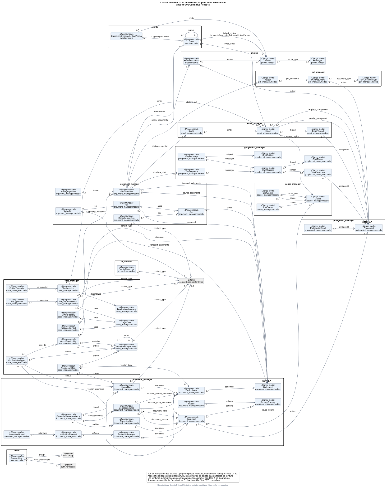

# Diagrammes de classes — état actuel du système

**Relevé du 20 octobre 2026**, depuis le code local au commit
`212a7feee81aef46a5b43d36e8eeafe0f8870064` (socle P6).
Cette série décrit les classes existantes et leurs responsabilités dans le code.
Elle complète [l’ERD](../erd_etat_actuel/README.md), qui décrit les tables et
leurs contraintes. Les [user stories C](../user_stories_architecture_c/README.md)
restent une cible distincte.

## Vue globale

[](00_vue_globale.svg)

Ouvrir la vue globale : **[SVG avec zoom](00_vue_globale.svg)** ·
[PNG](00_vue_globale.png) · [source PlantUML](00_vue_globale.puml).

Cette vue présente les **54 modèles du projet**, leurs associations et les
références externes nécessaires. Les attributs, opérations et héritages sont
développés dans les vues ci-dessous. Le SVG permet de parcourir la vue globale
sans réduire la taille des caractères des vues détaillées.
Dans le SVG, cliquer sur une classe du projet ouvre sa vue détaillée; les
références grises des autres vues permettent la même navigation.

## Vues détaillées

| Vue | Classes et responsabilités | Rendus | Source |
|---|---|---|---|
| 01 | Causes, Document, Statement, LibraryNode, schémas et numérotation | [SVG](01_causes_documents.svg) · [PNG](01_causes_documents.png) | [PlantUML](01_causes_documents.puml) |
| 02 | Référent historique, instantanés, VersionTexte, Correspondance, extrémités et archives | [SVG](02_historique_e01.svg) · [PNG](02_historique_e01.png) | [PlantUML](02_historique_e01.puml) |
| 03 | Bordereau de juillet, appuis, confirmations et ancrages de citation | [SVG](03_bordereau_appuis.svg) · [PNG](03_bordereau_appuis.png) | [PlantUML](03_bordereau_appuis.puml) |
| 04 | TrameNarrative, Axe, Fait, AppuiFait, RattachementAxe et PerjuryArgument | [SVG](04_argumentation.svg) · [PNG](04_argumentation.png) | [PlantUML](04_argumentation.puml) |
| 05 | LegalCase, pièces calculées, contestations, suggestions IA et transmissions | [SVG](05_dossiers_transmissions.svg) · [PNG](05_dossiers_transmissions.png) | [PlantUML](05_dossiers_transmissions.puml) |
| 06 | EmailThread, Email et Quote de courriel | [SVG](06_courriels.svg) · [PNG](06_courriels.png) | [PlantUML](06_courriels.puml) |
| 07 | PDFDocument, Quote de PDF, types PDF et protagonistes | [SVG](07_pdf_protagonistes.svg) · [PNG](07_pdf_protagonistes.png) | [PlantUML](07_pdf_protagonistes.puml) |
| 08 | Photo, PhotoDocument, Event et liaison photographique explicite | [SVG](08_photos_evenements.svg) · [PNG](08_photos_evenements.png) | [PlantUML](08_photos_evenements.puml) |
| 09 | Participants, fils, messages, sujets, groupes et séquences Google Chat | [SVG](09_google_chat.svg) · [PNG](09_google_chat.png) | [PlantUML](09_google_chat.puml) |
| 10 | CustomUser et GeminiResponse | [SVG](10_utilisateurs_ia.svg) · [PNG](10_utilisateurs_ia.png) | [PlantUML](10_utilisateurs_ia.puml) |
| 11 | Mixins partagés, HeriteQuoteManager, PhraseQuoteManager et QuoteRegime | [SVG](11_heritage_regimes.svg) · [PNG](11_heritage_regimes.png) | [PlantUML](11_heritage_regimes.puml) |
| 12 | NumeroResolu, Verdict, Rapport, contextes de protection et exceptions E01 | [SVG](12_classes_services_e01.svg) · [PNG](12_classes_services_e01.png) | [PlantUML](12_classes_services_e01.puml) |
| 13 | Adaptateur, ReferenceOccurrence, AuditIssue, PhotoProcessingService, EvidenceFormatter et EvidenceDeleteMixin | [SVG](13_import_audit_traitement.svg) · [PNG](13_import_audit_traitement.png) | [PlantUML](13_import_audit_traitement.puml) |

Chaque classe du périmètre possède exactement une vue complète. Lorsqu’elle est
nécessaire à une autre vue, elle apparaît en gris avec le stéréotype `ref`.
Les classes provenant de Django, Treebeard ou Python apparaissent comme
références `externe`, avec leur corps omis.

## Périmètre et couverture

| Élément extrait | Nombre |
|---|---:|
| Modèles concrets du projet | 54 |
| Énumérations TextChoices | 13 |
| Mixins Python | 3 |
| Gestionnaires personnalisés de citations | 2 |
| Dataclasses d’import et d’audit | 3 |
| Autres classes de service, résultat, contexte et exception | 14 |
| **Classes et énumérations du projet détaillées** | **89** |
| Opérations déclarées directement | 175 |
| Propriétés calculées déclarées | 25 |
| Diagrammes : une vue globale et treize détails | 14 |

L’inventaire comprend tous les modèles du projet enregistrés dans le relevé
ORM P6 et toutes les classes des modules de support explicitement listés dans
le générateur. Il ne prétend pas inventorier chaque classe des formulaires,
vues HTTP, administrations Django, commandes, tests ou bibliothèques externes.
Les tables M2M automatiques sont représentées par les associations entre objets;
elles ne deviennent pas des classes métier fictives. La liaison
`SupportingEvidenceLinkedPhotos`, écrite explicitement dans le code, reste
une vraie classe.

Pour rechercher une classe, ses bases, sa source et ses signatures complètes :

- [Dictionnaire des classes et opérations](DICTIONNAIRE_CLASSES.md).
- [Inventaire structuré, relations, couverture et empreintes](inventaire_classes.json).

## Lire les diagrammes

| Notation | Sens |
|---|---|
| Compartiment supérieur | Attributs ORM, attributs Python et propriétés calculées |
| Compartiment « Opérations déclarées » | Méthodes définies directement dans la classe |
| `+` | Nom public selon les conventions Python |
| `#` | Nom préfixé par `_`, convention non publique; ce n’est pas un contrôle d’accès Python |
| Membre souligné | Attribut de classe, `staticmethod` ou `classmethod`; ces dernières sont aussi signalées explicitement |
| Triangle vide | Héritage Python, y compris les mixins; aucun mixin n’est présenté comme une interface abstraite inexistante |
| Flèche pleine avec multiplicités | Relation ORM entre objets |
| Flèche pointillée | Dépendance vers un type de choix, gestionnaire, classe utilisée ou cible générique |
| `[0..1]` | Valeur nullable ou relation facultative; ce n’est pas la règle Django `blank` d’un formulaire |
| `property, readOnly` | Propriété calculée sans setter déclaré; elle n’est pas une colonne supplémentaire |
| `inherited` | Champ hérité d’une base abstraite, présent sur le modèle concret |
| `generic` | Résolution dynamique par ContentType et identifiant, sans FK SQL universelle vers l’objet |

Les types de champs sont des types de valeur abrégés (`str`, `int`, `date`,
`datetime`, etc.), projetés depuis les champs ORM. Les contraintes de longueur,
unicité, index et suppression sont détaillées dans l’ERD; elles ne sont pas
remplacées par des contraintes UML inventées.

Les signatures conservent les arguments et annotations présents dans le Python.
`self` et `cls` sont implicites. Pour les attributs Python ordinaires, une
annotation déclarée ou le type d’une initialisation littérale est affiché
lorsqu’il est disponible; les autres types restent non précisés. Le type d’une
initialisation n’est pas une garantie que l’attribut ne changera jamais de type.
Les longues signatures sont réparties sur plusieurs lignes dans les rendus.

Les méthodes héritées du framework et les méthodes produites automatiquement
par Django ou `dataclass` ne sont pas recopiées. Par exemple, une dataclass
possède un constructeur généré même si aucun `__init__` n’est écrit dans sa boîte.
Les dépendances des classes de support correspondent aux noms de classes
explicitement employés dans leur corps. Ce n’est pas un graphe exhaustif des
appels entre fonctions.

## Distinctions importantes dans l’existant

- `LibraryNode` hérite de `MP_Node`; son arbre utilise `path`, `depth` et
  `numchild`. Aucune relation `parent_id` n’est ajoutée. `Event.parent`, en
  revanche, est une véritable relation réflexive.
- Les sept `GenericForeignKey` peuvent désigner différentes classes. Leur
  dépendance générique vers `Model` ne les transforme pas en relations dédiées
  vers `Statement` ou une autre cible supposée.
- `email_manager.Quote` et `pdf_manager.Quote` sont deux classes distinctes.
  HERITE et PHRASE sont des valeurs de régime, avec des gestionnaires
  personnalisés. Ce dessin ne certifie pas les capacités futures de PHRASE.
- `Cause` et `LegalCase` restent deux modèles distincts, sans correspondance
  ajoutée par la documentation.
- `ProducedExhibit` reste une représentation temporaire recalculée.
  `Transmission` est le modèle existant, sans relation inventée à `VersionActe`.
- Les services tels que `document_manager.concordance` et
  `case_manager.cotation_service` utilisent principalement des fonctions de
  module. Aucune classe `ConcordanceService` ou `CotationService` n’est créée
  pour les représenter. La vue 12 montre les classes réellement écrites autour
  de ces fonctions.
- Une propriété `etat_courant` ou une dataclass `frozen=True` ne constitue pas
  une garantie d’immutabilité globale de la base et des fichiers. Les corrections
  C0-A de la copie isolée ne sont pas assimilées à une intégration dans P6.

Les futures classes `Acte`, `VersionActe`, `Preuve`, `UtilisationPreuve`,
`SelectionPreuve` et `ExamenEditorial` ne figurent pas comme classes existantes.
Cette série ne représente ni un schéma cible C, ni la proposition V2 examinée
sur un autre commit de `main`.

## Extraction et reproduction

Le [générateur](generer_classes.py) utilise uniquement la bibliothèque standard
Python : analyse AST des sources et lecture du relevé ORM déjà produit pour
l’ERD. Il refuse la génération si le commit ou l’une des douze empreintes de
fichiers de modèles ne correspond plus au relevé. Il n’importe aucune
application, aucun fichier de configuration réel et aucun `.env`; il n’ouvre
aucune connexion à une base ni au réseau.

Les classes de support sont extraites directement de leurs fichiers actuels.
Leurs empreintes, les emplacements des classes et les relations sont conservés
dans l’inventaire. Le générateur ne réinspecte pas le schéma du serveur ni les
migrations appliquées.

Depuis la racine du dépôt :

```sh
python3 -B docs/modele_preuve/diagrammes/classes_etat_actuel/generer_classes.py --date 2026-10-20
```

Puis, depuis ce répertoire :

```sh
plantuml -charset UTF-8 -checkonly '*.puml'
PLANTUML_LIMIT_SIZE=16000 plantuml -charset UTF-8 -nbthread 2 -tsvg '*.puml'
PLANTUML_LIMIT_SIZE=16000 plantuml -charset UTF-8 -nbthread 2 -tpng '*.puml'
```

`style.iuml` est local; aucune inclusion distante n’est nécessaire. La limite
d’image est augmentée pour conserver les caractères et éviter de tronquer les
grandes vues. PlantUML utilisé : **1.2026.8**.
Les cartes de liens `.cmapx` produites avec certains PNG sont des fichiers
auxiliaires ignorés par Git; les liens des SVG sont directement utilisables.

## Vérifications de livraison

Vérifications effectuées le 20 octobre 2026 :

- Syntaxe PlantUML validée pour les **14 sources**; génération réussie des
  **14 SVG et 14 PNG**.
- Couverture contrôlée : les 89 classes possèdent chacune une seule vue
  complète; leurs attributs ORM, 175 opérations et 25 propriétés sont présents.
- Empreintes des sources contrôlées, liens Markdown et **102 liens de navigation
  SVG** vérifiés vers des fichiers existants.
- PNG ouverts et décodés, planche d’ensemble inspectée, contrôle visuel détaillé
  des vues globale, documents, héritage et traitement.

Ces vérifications portent sur la documentation et ses rendus. Aucun test
applicatif, accès à la base réelle, migration ou opération Git de publication
n’est exécuté pour cette livraison. Les diagrammes antérieurs sont conservés;
seul un lien vers cette nouvelle série est ajouté à leur index parent.
