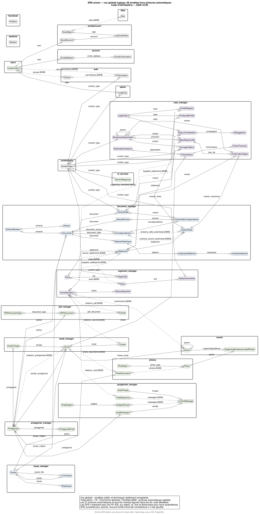

# Entity-Relationship Diagram — état actuel du système

**Relevé du 20 octobre 2026**, depuis les modèles Django du dépôt au commit
`212a7feee81aef46a5b43d36e8eeafe0f8870064`, avec les dépendances de l’environnement
Python local. Ce schéma décrit **ce que le code déclare actuellement**.
L’état des migrations appliquées et les données de la base réelle ne sont pas
consultés; ce relevé ne prétend donc pas certifier le schéma déployé du serveur.

## Vue globale et périmètre

[](00_vue_globale.svg)

Ouvrir la vue globale : [SVG avec zoom](00_vue_globale.svg) ·
[PNG](00_vue_globale.png) · [source PlantUML](00_vue_globale.puml).

L’inventaire complet contient :

| Élément | Nombre |
|---|---:|
| Modèles concrets du projet | 54 |
| Modèles techniques enregistrés : Django, allauth, miniatures | 12 |
| Tables de jointure M2M créées automatiquement | 21 |
| **Tables déclarées au total** | **87** |
| Colonnes | 588 |
| Champs FK, OneToOne inclus, jointures comprises | 116 |
| Champs ManyToMany | 22 |
| GenericForeignKey | 7 |

La vue globale présente les **66 modèles hors jointures automatiques** avec
leurs relations. Les 21 jointures automatiques y sont repliées en liens M:N
pointillés. La table explicite Event↔Photo reste une entité visible.
Les vues détaillées montrent les **87 tables, leurs champs et les jointures**,
sans créer d’entité fictive pour les références génériques.

`core` et `video_manager` sont des applications présentes mais ne déclarent
aucun modèle concret à ce relevé. Les modèles abstraits, mixins, énumérations,
propriétés et fonctions de service ne sont pas des tables.
Les tables internes PostgreSQL et `django_migrations`, qui n’est pas un
modèle enregistré, ne font pas partie de cet inventaire ORM.

## Vues détaillées

Chaque table possède une vue où tous ses champs sont exposés. Une table
référencée depuis un autre domaine apparaît en gris avec sa seule clé primaire;
son schéma complet se trouve dans sa propre vue. Chaque FK est ainsi décrite
au départ de la table qui la porte, même si le domaine cible est différent.

| Vue | Contenu | Diagramme | Source |
|---|---|---|---|
| 01 | Causes, états et liens de causes; documents, Statements, occurrences, niveaux et schémas | [SVG](01_causes_documents.svg) · [PNG](01_causes_documents.png) | [PlantUML](01_causes_documents.puml) |
| 02 | Référent historique, instantanés, VersionTexte, Correspondance, extrémités et archives | [SVG](02_historique_e01.svg) · [PNG](02_historique_e01.png) | [PlantUML](02_historique_e01.puml) |
| 03 | BordereauDepotJuillet, AppuiDepotJuillet, ConfirmationAppui et AncrageCitation | [SVG](03_bordereau_appuis.svg) · [PNG](03_bordereau_appuis.png) | [PlantUML](03_bordereau_appuis.puml) |
| 04 | Ancien pont : TrameNarrative, PerjuryArgument, Axe, Fait, AppuiFait et RattachementAxe | [SVG](04_argumentation.svg) · [PNG](04_argumentation.png) | [PlantUML](04_argumentation.puml) |
| 05 | LegalCase, contestations, suggestions IA, registres de pièces, destinataires, transmissions et fichiers | [SVG](05_dossiers_transmissions.svg) · [PNG](05_dossiers_transmissions.png) | [PlantUML](05_dossiers_transmissions.puml) |
| 06 | Protagonistes, courriels, fils, PDF et les deux modèles Quote | [SVG](06_courriels_pdf_protagonistes.svg) · [PNG](06_courriels_pdf_protagonistes.png) | [PlantUML](06_courriels_pdf_protagonistes.puml) |
| 07 | Photos, PhotoDocument, Event et jointures photographiques | [SVG](07_photos_evenements.svg) · [PNG](07_photos_evenements.png) | [PlantUML](07_photos_evenements.puml) |
| 08 | Participants, fils, messages, sujets, groupes et séquences Google Chat | [SVG](08_google_chat.svg) · [PNG](08_google_chat.png) | [PlantUML](08_google_chat.puml) |
| 09 | CustomUser, ses jointures de droits et GeminiResponse | [SVG](09_utilisateurs_ia.svg) · [PNG](09_utilisateurs_ia.png) | [PlantUML](09_utilisateurs_ia.puml) |
| 10 | Authentification, ContentType, journal d’administration, sessions, sites, allauth et miniatures | [SVG](10_tables_techniques.svg) · [PNG](10_tables_techniques.png) | [PlantUML](10_tables_techniques.puml) |

Pour rechercher une table ou un champ :

- [Dictionnaire complet des modèles, tables, colonnes et contraintes](DICTIONNAIRE_MODELES.md).
- [Métadonnées structurées, couverture des vues et empreintes des sources](schema_modeles.json).

Le dictionnaire conserve les noms de tables particuliers, notamment
`SupportingEvidence_supportingevidence` pour `events.Event` et
`SupportingEvidence_supportingevidence_linked_photos` pour sa jointure explicite.
Ils ne sont pas renommés selon le nom actuel de l’application.

`email_manager.Quote` et `pdf_manager.Quote` sont deux modèles distincts.
Dans chacun, HERITE et PHRASE sont les valeurs du champ `regime`, pas deux
tables supplémentaires. La présence de ce champ ne certifie pas à elle seule
que les capacités de certification PHRASE de l’étape suivante sont livrées.

## Lire les relations

| Symbole ou indication | Sens |
|---|---|
| `PK` | Clé primaire |
| `FK` | Champ de clé étrangère déclaré |
| `UQ` | Unicité simple ou composée; les contraintes conditionnelles sont identifiées séparément |
| `*` devant un champ | `null=False`, pas une interdiction de chaîne vide ni une obligation d’interface |
| `?` | `null=True` |
| `\|\|` | Exactement un |
| `\|o` / `o\|` | Zéro ou un |
| `o{` / `}o` | Zéro à plusieurs |
| Entité grise `ref` | Table réelle détaillée dans une autre vue |
| Entité ocre `M2M auto` | Table de jointure automatique réellement déclarée par Django |
| Pointillés M2M dans la vue globale | Jointure repliée pour la synthèse; la table réelle est développée dans les détails |

Pour une FK obligatoire, chaque ligne enfant vise exactement un parent,
mais le parent peut n’avoir **aucun** enfant. Pour une OneToOne obligatoire,
chaque enfant vise un parent et chaque parent peut n’avoir que zéro ou un enfant.
Une FK nullable rend aussi la référence au parent facultative. Une M2M n’impose
pas à elle seule un minimum d’un lien en base, même si le formulaire peut l’exiger.

Les types affichés sont des types **Django abrégés**, pas un DDL PostgreSQL
introspecté. Les suffixes `/ CASCADE`, `/ PROTECT`, `/ SET_NULL`, etc. désignent
la politique `on_delete` du modèle Django; ils ne certifient pas qu’un
`ON DELETE CASCADE` SQL équivalent est installé dans une base.

Les contraintes de `Meta` figurent dans le dictionnaire et les vues. Les
validations de `clean()`, signaux et services restent des comportements
applicatifs : elles ne sont pas transformées ici en contraintes SQL inventées.
Une relation dessinée ne prouve pas non plus l’immutabilité de ses objets.

## Références génériques et identifiants conservés

Sept modèles portent une `GenericForeignKey` :

| Propriétaire | Champs physiques de résolution |
|---|---|
| `document_manager.LibraryNode` | `content_type_id` + `object_id` |
| `argument_manager.AppuiFait` | `content_type_id` + `object_id` |
| `argument_manager.RattachementAxe` | `content_type_id` + `object_id` |
| `case_manager.BordereauDepotJuillet` | `content_type_id` + `object_id` |
| `case_manager.ExhibitRegistry` | `content_type_id` + `object_id` |
| `case_manager.ProducedExhibit` | `content_type_id` + `object_id` |
| `ai_services.GeminiResponse` | `content_type_id` + `object_id` |

Le lien vers `ContentType` est une vraie FK déclarée. `object_id` reste une
colonne scalaire : il n’existe pas une FK SQL universelle vers l’objet pointé.
En particulier, `LibraryNode → Statement` est un usage de référence générique,
pas une FK dédiée dessinable comme telle. Les cibles possibles ne sont pas
déduites de lignes de données, puisque aucune donnée n’a été consultée.

De même, les identifiants conservés comme `statement_pk` et `noeud_pk` dans
les instantanés/archives ne deviennent pas des FK par leur seul nom.
L’arbre Treebeard de `LibraryNode` utilise `path`, `depth` et `numchild`;
aucune colonne `parent_id` n’est inventée. `Event.parent`, en revanche,
est une FK réflexive réelle et figure dans la vue photographique.

## Ce qui existe et ce qui reste une cible de conception

Ce relevé contient l’ancien pont d’argumentation et les structures E01
effectivement présentes. Il ne contient pas de tables `Acte`, `VersionActe`,
`Preuve`, `NoeudPreuve`, `UtilisationPreuve`, `SelectionPreuve`,
`LienRedactionnel` ou `ExamenEditorial` : elles ne sont pas des modèles
enregistrés de ce code à la date du relevé.

`case_manager.Transmission` est le modèle de transmission **déjà existant**;
il n’est pas présenté comme la future transmission d’une VersionActe.
`cause_manager.Cause` et `case_manager.LegalCase` sont deux modèles distincts;
aucune correspondance entre eux n’est ajoutée au schéma.

Le lot C0-A livré dans une copie isolée ne modifiait aucun schéma. Ses garanties
et ses résultats de tests ne sont pas assimilés à un déploiement dans ce dépôt.
Les [user stories de C](../user_stories_architecture_c/README.md) restent une
documentation séparée de la cible fonctionnelle.

## Extraction et vérification

Le générateur [generer_erd.py](generer_erd.py) charge le registre Django sous
des settings autonomes : constantes des applications lues par AST, moteur
de base factice et connexions refusées. Il n’importe pas les settings réels
et refuse la lecture de `.env*` et les connexions réseau.

Il relève les champs concrets, PK/FK/OneToOne, M2M et leurs tables `through`,
GFK, noms de colonnes/tables et contraintes de modèles. Il inclut les champs
hérités des modèles abstraits, notamment ceux d’AbstractUser et MP_Node.
Chaque table est affectée exactement une fois à une vue complète; les autres
occurrences sont des références explicites.

La comparaison **en mémoire**, sans connexion, des modèles avec l’état final
des fichiers de migrations ne détecte pas d’écart. Cela vérifie la cohérence
du code et de ses migrations, pas leur application dans une base donnée.
Aucune migration n’est générée ni appliquée par ce travail.

Pour reproduire depuis la racine du dépôt :

```sh
.venv/bin/python -B docs/modele_preuve/diagrammes/erd_etat_actuel/generer_erd.py --date 2026-10-20
```

Puis, depuis ce répertoire :

```sh
plantuml -charset UTF-8 -checkonly *.puml
plantuml -charset UTF-8 -tsvg *.puml
plantuml -charset UTF-8 -tpng *.puml
```

Le SVG permet de zoomer dans les vues denses. Les PNG sont des aperçus limités
en dimensions pour conserver l’ensemble du graphe sans coupure. Le générateur
ne rend pas les images lui-même : il faut les régénérer après les sources.
Si de nouveaux modèles sont ajoutés, leur affectation aux vues doit être
actualisée : le générateur refuse une table sans vue détaillée.

Cette livraison ajoute seulement la documentation ERD et son outil de
génération. Les modèles, migrations, données, scripts de l’Agent A et
diagrammes précédents sont conservés.

Validation du relevé : **11 sources PlantUML compilées, 11 SVG et 11 PNG**.
La couverture a été contrôlée pour les **87 tables, 588 colonnes et 116 FK**,
avec une seule vue complète par table. Les liens de l’index sont vérifiés.
Le fichier `.gitignore` local permet uniquement de conserver le JSON de
métadonnées de ce dossier malgré la règle générale du dépôt sur les JSON.
