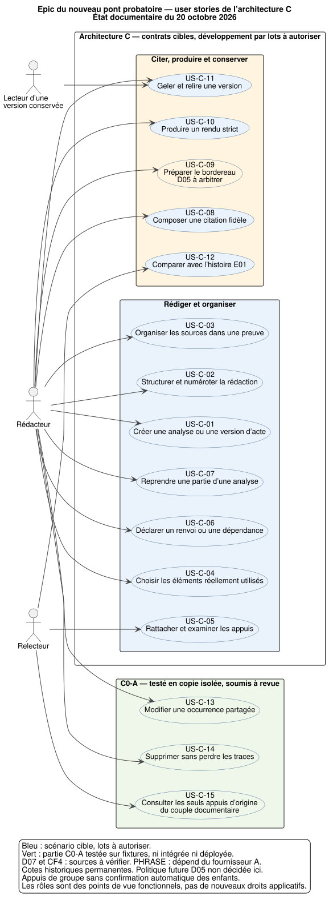

# User stories — Epic du nouveau pont probatoire, architecture C

État documentaire : **20 octobre 2026**. Cette série traduit les contrats
de l’architecture C en parcours utilisateur. Elle comprend **15 user stories,
une vue d’ensemble et les sources PlantUML avec leurs rendus SVG/PNG**.
Les identifiants `US-C-xx` sont propres à cette série; ils ne renumérotent ni
les exigences E01 ni les scénarios de tests déjà définis.

## Lecture et statut



Vue d’ensemble : [PlantUML](00_vue_ensemble.puml) ·
[SVG](00_vue_ensemble.svg) · [PNG](00_vue_ensemble.png).

- **US-C-01 à US-C-12 : cible fonctionnelle.** Les orientations sont approuvées
  selon le mandat utilisateur, avec leurs conditions. Le développement des
  lots suivants reste à autoriser.
- **US-C-13 à US-C-15 : périmètre C0-A testé isolément, soumis à revue.** Le
  rapport du 19 octobre relève 209 tests réussis, dont 31 nouveaux tests C0-A.
  Ce résultat ne signifie ni intégration, ni déploiement, ni gel global réalisé.
- **D05 reste en arbitrage.** Les cotes historiques demeurent permanentes.
  Aucun diagramme ne décide une nouvelle politique de cotation ou de sous-cotation.
- **D07 et CF4 restent conditionnelles à la vérification des sources.** Le
  chemin PHRASE dépend des capacités effectivement fournies par l’Agent A.

« Rédacteur », « Relecteur » et « Lecteur » sont des points de vue fonctionnels.
Ils ne créent pas de nouveaux comptes, rôles de sécurité ou pouvoirs de validation.
Les diagrammes d’activité décrivent des parcours et des refus utiles; ils ne
constituent pas des spécifications exhaustives d’API ou de permissions.

Cette série remplace la chaîne conceptuelle Démonstration/Poignée **pour la
lecture de l’architecture C** : une cible rédactionnelle reçoit 0..N
`UtilisationPreuve`, chacune avec une preuve et ses sélections explicites.
Les cinq diagrammes du répertoire parent restent des documents historiques
de la proposition du 16 octobre et sont conservés tels quels.

## Index et découpage en lots

| Story | Valeur pour l’utilisateur | Lots concernés | Parcours |
|---|---|---|---|
| US-C-01 | Commencer une analyse autonome ou une version d’acte dans le bon contexte | L1-A | [SVG](01_contexte_versionne.svg) · [source](01_contexte_versionne.puml) |
| US-C-02 | Organiser librement la rédaction avec des repères cohérents | L1-A / L1-B | [SVG](02_structure_numerotation.svg) · [source](02_structure_numerotation.puml) |
| US-C-03 | Classer des sources réutilisables sans dupliquer les conclusions | L2 | [SVG](03_organiser_preuve.svg) · [source](03_organiser_preuve.puml) |
| US-C-04 | Choisir précisément les éléments invoqués pour chaque cible | L2 / L3-A | [SVG](04_selection_effective.svg) · [source](04_selection_effective.puml) |
| US-C-05 | Distinguer les appuis retenus de l’examen de la transformation éditoriale | L1-A / C0-B / L2 | [SVG](05_rattachement_examen.svg) · [source](05_rattachement_examen.puml) |
| US-C-06 | Rendre visibles les renvois et prémisses expressément invoqués | L1-B, L5 / L6 | [SVG](06_liens_redactionnels.svg) · [source](06_liens_redactionnels.puml) |
| US-C-07 | Reprendre une partie d’analyse avec son contexte décidé explicitement | L2, primitives L1 / C0-B | [SVG](07_reprise_partielle.svg) · [source](07_reprise_partielle.puml) |
| US-C-08 | Composer et insérer des citations fidèles aux sources | L3-B / L4 | [SVG](08_citation_composite.svg) · [source](08_citation_composite.puml) |
| US-C-09 | Préparer un bordereau traçable sans contourner la politique de cotes | L3-A, arbitrage D05 | [SVG](09_bordereau_cotation.svg) · [source](09_bordereau_cotation.puml) |
| US-C-10 | Obtenir des sorties cohérentes ou des diagnostics précis | L3 / L4, L6 | [SVG](10_rendu_strict.svg) · [source](10_rendu_strict.puml) |
| US-C-11 | Conserver puis relire exactement une version gelée | L5 / L6 | [SVG](11_gel_conservation.svg) · [source](11_gel_conservation.puml) |
| US-C-12 | Comparer les versions sans transformer l’histoire en nouvelle validation | C0-B / L6, journal L1-A | [SVG](12_concordance_historique.svg) · [source](12_concordance_historique.puml) |
| US-C-13 | Modifier une occurrence sans modifier les autres | C0-A, revue attendue | [SVG](13_c0a_edition_partagee.svg) · [source](13_c0a_edition_partagee.puml) |
| US-C-14 | Supprimer un bloc autorisé sans perdre ses traces utiles | C0-A, revue attendue | [SVG](14_c0a_suppression_archivee.svg) · [source](14_c0a_suppression_archivee.puml) |
| US-C-15 | Consulter les seuls appuis historiques de la bonne origine documentaire | C0-A, revue attendue | [SVG](15_c0a_appuis_origine.svg) · [source](15_c0a_appuis_origine.puml) |

Les critères ci-dessous décrivent le comportement attendu. Les références
`C:Txx`, `VFxx`, `NRxx`, `CF3-xx`, `IMxx` et `TRxx` renvoient au plan consolidé;
leur présence ici ne signifie pas qu’ils sont exécutés. Les 38 scénarios
NR01–NR12 / CF3-01–CF3-26 restent conservés et ne sont pas remplacés par ces stories.

## US-C-01 — Créer une analyse ou une version d’acte

**En tant que rédacteur, je veux travailler dans une analyse autonome ou une
version d’acte identifiée, afin de réutiliser mes recherches sans inventer un
dépôt ou une transmission.**

Critères d’acceptation :

- Chaque version possède un Document PRODUCED propre et un contexte explicite.
- Une analyse interne peut être rédigée puis gelée volontairement sans envoi.
- Les usages appartiennent à la version utilisatrice; les causes d’origine des sources restent distinctes.

Contrats : D12, CF1. Références : VF01/VF08, CF3-01/02/16/23.

## US-C-02 — Structurer et numéroter la rédaction

**En tant que rédacteur, je veux déplacer et imbriquer mes propositions,
groupes et réserves, afin d’essayer plusieurs plans avec une numérotation cohérente.**

Critères d’acceptation :

- L’identité d’une occurrence ne dépend ni du numéro affiché ni du Statement partagé.
- Le Document entier est numéroté avant tout filtrage d’affichage; profondeur et rôle ne se confondent pas.
- LEGACY et STORED gardent leur contrat; le nouveau profil demande une activation explicite et n’impose pas Observation/Réfutation.

Contrats : D03/D09. Références : C:T01–T05/T22, E01:T05–T10/T17, NR02.

## US-C-03 — Organiser les sources dans une preuve

**En tant que rédacteur, je veux regrouper mes éléments documentaires dans une
preuve réutilisable, afin de les retrouver sans recopier mes conclusions dans
un second arbre.**

Critères d’acceptation :

- L’arbre organise des groupes et des feuilles référencées aux sources; seules les branches de groupe portent des enfants.
- Une source seule utilise le même contrat de preuve, d’usage et de sélection qu’un ensemble composé.
- Classer une source ne crée ni appui rédactionnel, ni pièce utilisée dans une version; aucun renvoi récursif entre preuves n’est introduit.

Contrats : D01/D11/D12. Références : C:T06/T07/T17/T21, VF13, CF3-08/24.

## US-C-04 — Choisir les éléments réellement utilisés

**En tant que rédacteur, je veux choisir les branches et feuilles utiles à
chaque proposition ou groupe, afin de ne pas invoquer implicitement tout le
contenu d’une preuve.**

Critères d’acceptation :

- Une utilisation valide comprend une preuve et 1..N sélections explicites; plusieurs utilisations peuvent servir la même cible.
- Les branches non choisies n’entrent pas dans le résultat par leur seule présence; un appui de groupe n’est pas hérité par ses enfants.
- Pour Photo→Event, le contenant et l’appartenance sont vérifiés; seules les photos choisies sont invoquées, et l’Event original reste entier. CF4 demeure conditionnelle.

Contrats : D01/D02, CF4. Références : C:T08/T12/T21, VF03/VF14, CF3-07/08/12/24.

## US-C-05 — Rattacher des appuis et examiner la filiation

**En tant que relecteur, je veux distinguer l’examen d’une transformation
éditoriale de l’examen de ses appuis, afin qu’une confirmation ne valide pas
silencieusement l’autre question.**

Critères d’acceptation :

- La cible peut recevoir 0..N usages; une sélection et une portée explicitent les éléments mobilisés.
- Un examen éditorial nouveau conserve les occurrences des deux côtés, textes, qualification, couple, motif et auteur dans un manifeste immuable.
- Un conflit avec l’état attendu refuse l’ajout sans écraser l’ancienne décision; les garanties du journal relèvent de L1-A/C0-B.

Contrats : D01/D02, CF3-D2. Références : NR03/06/12, IM01–IM08, TR01–TR06.

## US-C-06 — Déclarer les renvois et dépendances

**En tant que rédacteur, je veux indiquer les passages auxquels je renvoie
et les prémisses que j’invoque expressément, afin de rendre mon raisonnement
navigable et de repérer les liens devenus périmés.**

Critères d’acceptation :

- Un RENVOI peut être réciproque; une DEPENDANCE_DECLAREE ne peut créer de cycle, même avec des liens à réexaminer.
- Le contrôle de fraîcheur porte sur les occurrences et textes concernés; une dépendance externe stricte vise une version gelée ou exige la reprise explicite de sa prémisse.
- Aucun lien ne copie automatiquement le texte, les sélections probatoires ou une validation logique.

Contrat : CF2. Références : VF05–VF11, CF3-12/14–18/21.

## US-C-07 — Reprendre une partie d’une analyse

**En tant que rédacteur, je veux reprendre un sous-arbre dans une autre
rédaction avec les seuls usages et liens que je décide de conserver, afin
de réutiliser mon travail sans perdre ses limites ni altérer la source.**

Critères d’acceptation :

- Le plan traite les réserves, prémisses, usages d’ancêtres et liens hors bloc; les réserves sont incluses par défaut et les omissions sont motivées.
- L’application crée de nouvelles occurrences et usages destination, puis une filiation qualifiée par couple avec groupes N:M exacts.
- Plan périmé ou échec d’une étape : annulation entière. Une source gelée reste réutilisable sans mutation; absence de sélection n’équivaut pas à RETRAIT E01.

Contrats : CF3, CF3-D1/D3/D4/D5. Références : CF3-01–26, VF02–VF05/VF08.

## US-C-08 — Composer une citation fidèle

**En tant que rédacteur, je veux composer une citation à partir des passages
sources identifiés et l’insérer dans la bonne occurrence, afin d’en conserver
le verbatim, les repères et les transformations visibles.**

Critères d’acceptation :

- Le verbatim vient du fournisseur; PHRASE exige sa certification effective et ses ancrages courants. D07 exige la vérification du passage d’acte sur l’original.
- Les segments sont ordonnés; omissions et emphases sont déclarées. Les chevauchements ambigus sont refusés plutôt que fusionnés ou tronqués silencieusement.
- Une insertion vise l’occurrence, le Statement porté et sa VersionTexte; des textes modifiés imposent réancrage. L’occurrence complète reste l’unité de fragment d’acte, distincte d’une future sous-cote.

Contrats : D04/D07/D10, contrat A. Références : C:T09–T11/T18/T19, C:N01/N03–N05, VF04.

## US-C-09 — Préparer le bordereau sans contourner D05

**En tant que rédacteur, je veux retrouver les pièces et fragments réellement
utilisés avec leurs dates et identités, afin de préparer un bordereau cohérent
sans réaffecter les cotes historiques.**

Critères d’acceptation :

- Une identité documentaire n’apparaît pas deux fois parce qu’elle est mobilisée comme source entière et fragment; ses chemins d’usage restent visibles.
- L’ordre dépend des dates métier vérifiées et de leur précision; aucune heure ni date de repli n’est inventée. A_DATER bloque le strict concerné.
- Les cotes déjà attribuées demeurent permanentes. Tant que D05 n’est pas tranchée, seuls identités et rangs de travail peuvent préparer la nouvelle cotation C, sans nouvelle cote procédurale contradictoire ni sous-cote active nouvelle.

Contrats : D04/D05/D06, CF4. Références : C:N02/N07/N09/N10, NR08, CF3-24.

## US-C-10 — Produire un rendu strict cohérent

**En tant que rédacteur, je veux obtenir des sorties issues d’un résultat
commun, ou des diagnostics précis lorsque des conditions manquent, afin de
ne pas présenter une version insuffisamment vérifiée comme prête.**

Critères d’acceptation :

- Texte, citations, renvois, numéros et bordereau sont rendus depuis le même ResultatVersion.
- Les contrôles de sources, sélection, examens, appuis, liens et cotation sont cumulatifs; une ancienne confirmation sans manifeste ne dispense pas du nouvel examen requis.
- Les conditions D05/D07/CF4 et les capacités de A sont vérifiées pour les chemins concernés; une vue diagnostique n’est pas un strict accepté ni une preuve de vérité.

Contrats : D06/D07/D10, CF3-D2. Références : EX01–EX07 du contrat E01 renforcé, TR06, C:T14/T18/T19.

## US-C-11 — Geler et relire une version

**En tant que rédacteur puis lecteur, je veux conserver l’ensemble exact
d’une version validée et le relire à l’identique, afin qu’une modification
ultérieure du travail ou d’une source ne change pas son histoire.**

Critères d’acceptation :

- Le gel recontrôle sous verrou le contenu et les fichiers, conserve tout ce qui a été utilisé et active les protections de base et de stockage avant finalisation.
- La relecture utilise le contenu et les livrables conservés, sans recalcul depuis les relations vivantes; une preuve engagée dans un gel se copie entièrement avant modification.
- Une transmission est un événement distinct. Une analyse peut être gelée sans envoi et une version gelée peut être source d’une reprise vers un nouveau brouillon.

Contrats : D08, CF1, CF3-D5. Références : C:T16/T20, C:N06/N08/N11–N14, CF3-16–19/25.

## US-C-12 — Consulter la concordance historique

**En tant que relecteur, je veux distinguer la décision historique, sa
compatibilité actuelle et l’admissibilité à un nouvel export strict, afin
de conserver l’histoire sans fabriquer de validation passée.**

Critères d’acceptation :

- La lecture respecte la nature et le couple de filiation; les archives et lacunes restent identifiables.
- Aucun manifeste ancien n’est reconstruit depuis le présent. Un RELEVE_HERITE daté du jour conserve uniquement les informations disponibles avant remplacement d’une ancienne projection.
- Un nouvel examen explicite porte la date et les occurrences actuelles; un contenu gelé n’est pas modifié pour réparer sa lacune. Les arbres internes postérieurs ne sont pas présentés comme remis avec l’acte papier de juillet.

Contrats : CF3-D1/D2/D5. Références : NR04/06/09/10/12, IM06, TR01–TR06.

## US-C-13 — Modifier une occurrence partagée — C0-A

**En tant que rédacteur, je veux modifier une occurrence sans modifier les
autres occurrences du même texte, afin de préserver la source et de voir
quelles confirmations doivent être réexaminées.**

Critères d’acceptation couverts par le banc C0-A :

- L’édition HTTP détache le Statement partagé et conserve le texte initial des autres occurrences; le référent historique et REPRODUCED refusent l’édition.
- L’identité du Statement réellement porté et le texte courant déterminent la fraîcheur. Un autre Statement de même texte périme aussi la confirmation; un texte identique sauvegardé sans substitution ne la périme pas.
- Captures et ancien état restent lisibles; un refus tardif annule les nouveaux objets. Cela ne garantit pas encore l’historique complet des reconfirmations ou la résistance au SQL direct.

Contrat : partie C0-A de CF3-D4, NR03/NR11/TR02.
Tests de référence : `C0AEditionEtConservation` et `C0AFraicheurEtPerimetre`
dans les deux modules E01 du patch livré. Parcours actuel de la copie isolée,
sans attestation d’exécution sur le dépôt principal.

## US-C-14 — Supprimer sans perdre les traces — C0-A

**En tant que rédacteur, je veux retirer un bloc autorisé tout en conservant
les textes et décisions encore nécessaires, afin que la concordance reste
consultable et qu’un refus n’efface rien partiellement.**

Critères d’acceptation couverts par le banc C0-A :

- Le bloc entier est précontrôlé avant archivage; une protection historique ou une confirmation/ancrage que P6 ne sait pas archiver entraîne le refus entier.
- Une suppression autorisée conserve les archives, repointe les extrémités et protège les captures utilisées; un identifiant d’un autre type n’entraîne aucune purge de Statement homonyme.
- Une panne annule archives, changements de liens et suppressions. Le refus conservateur ne constitue ni un nouveau journal ni une garantie globale d’immutabilité.

Contrat : partie C0-A de CF3-D4, NR11 et conservation des captures.
Tests de référence : `C0AEditionEtConservation`, et
`test_suppression_avec_decision_dappui_refuse_tout_le_bloc`.

## US-C-15 — Consulter les bons appuis d’origine — C0-A

**En tant que relecteur, je veux consulter les seuls appuis historiques du
couple documentaire demandé, afin de ne pas les confondre avec ceux d’une
autre origine ou avec les appuis actuels de la rédaction.**

Critères d’acceptation couverts par le banc C0-A :

- Le lecteur et l’export filtrent le couple et vérifient appartenance et ContentType; un ancien appel ambigu exige une source explicite.
- Source archivée de type inconnu, absente ou incompatible : diagnostic, sans appui fabriqué à partir du seul identifiant numérique; l’export conserve sa ligne et le diagnostic.
- La lecture ne crée aucun appui ni examen actuel. Le filtrage par `nature` et le traitement historique complet attendent L1-A/C0-B.

Contrat : partie C0-A de NR07 et du noyau typé CF3-26.
Tests de référence : les cinq tests de lecteur/export/type/archive de
`C0AFraicheurEtPerimetre`.

## Références et limites de cette livraison documentaire

Sources utilisées, sans les remplacer :

1. [Décisions consolidées de l’architecture C, 19 octobre 2026](/private/tmp/court-agent-b-validation-c-20261019/DECISIONS_ARCHITECTURE_C_CONSOLIDEES.md),
   puis le mandat utilisateur « Approbation architecturale et autorisation limitée du lot C0-A ».
   Les statuts d’approbation de cette série viennent du mandat, pas de la seule présence dans le rapport.
2. [Rapport d’exécution C0-A](/private/tmp/court-agent-b-c0a-20261019-bmr16wwh/artifacts/RAPPORT_EXECUTION_C0A.md),
   résultats et limites du lot isolé à partir de P6 `212a7feee81aef46a5b43d36e8eeafe0f8870064`.
3. [Conception antérieure](../../CONCEPTION_PREUVE.md) et
   [contexte des causes](../../ARCHITECTURE_CAUSES.md), lus comme contexte historique.

Les deux rapports sont des artefacts locaux préexistants, hors de cette branche.
L’index et les critères ci-dessus restent lisibles sans eux; leurs liens absolus
permettent de retrouver ici les sources exactes tant que ces artefacts sont conservés.

Le socle de référence de C0-A, les scripts/pilote de A, le code applicatif,
les migrations, les données et les archives gelées ne sont pas modifiés par
cette documentation. Aucun lot de développement suivant n’est engagé.
Les rendus PlantUML vérifient la syntaxe et la lisibilité des scénarios,
pas leur implémentation ni leurs tests fonctionnels.

## Régénérer les images

Depuis ce répertoire, avec PlantUML installé localement :

```sh
plantuml -charset UTF-8 -tsvg *.puml
plantuml -charset UTF-8 -tpng *.puml
```

`style.iuml` est une inclusion locale commune. Il ne faut pas ajouter de
point-virgule dans le texte d’une activité : il en termine la déclaration.

Validation documentaire du 20 octobre 2026 : syntaxe et génération vérifiées
avec PlantUML **1.2026.8**; 16 sources, 16 SVG et 16 PNG. Les liens de cet index
ont été contrôlés. Les tests applicatifs C0-A cités plus haut sont ceux du
rapport du 19 octobre, sans nouvelle exécution applicative dans ce travail.
